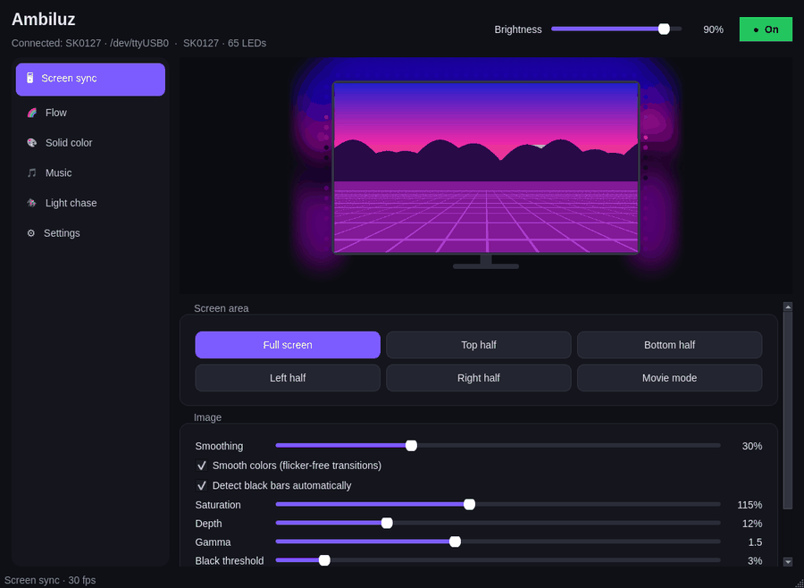
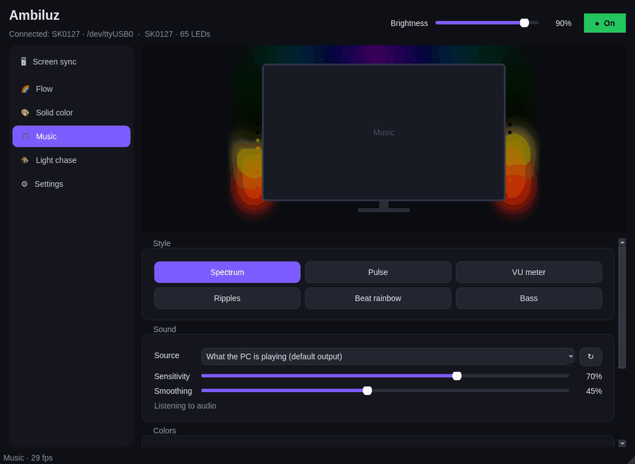
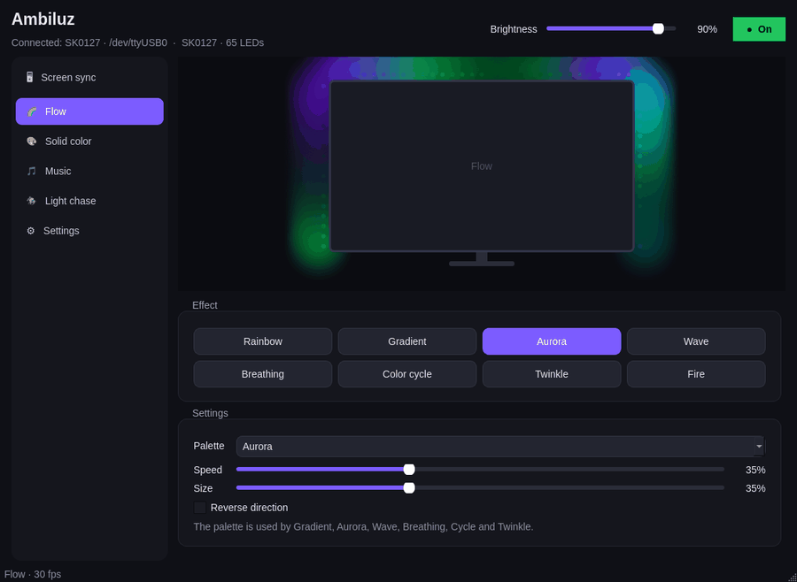
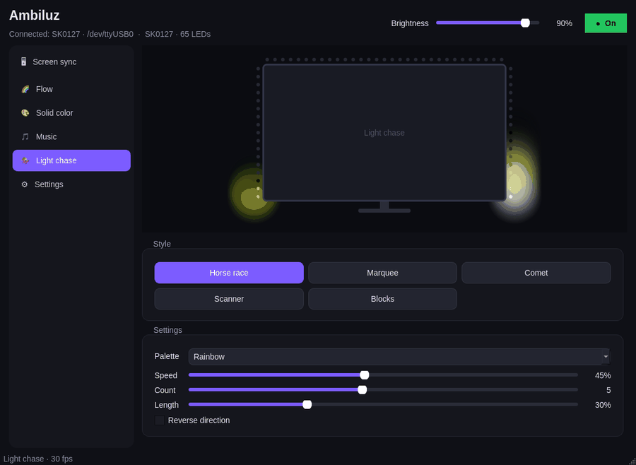
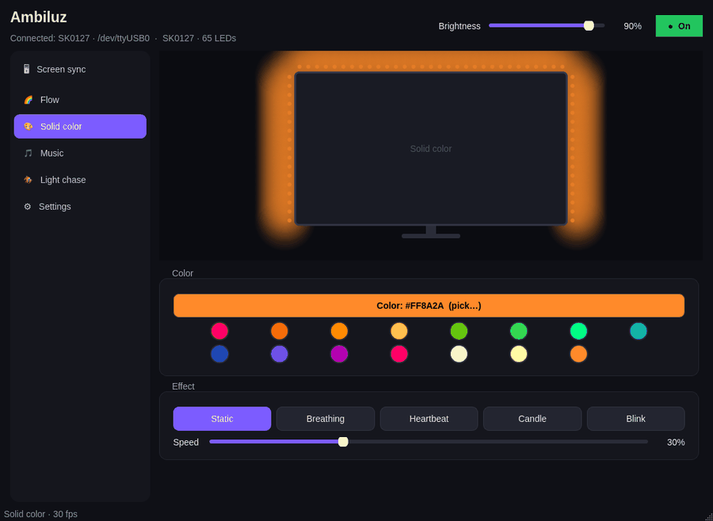
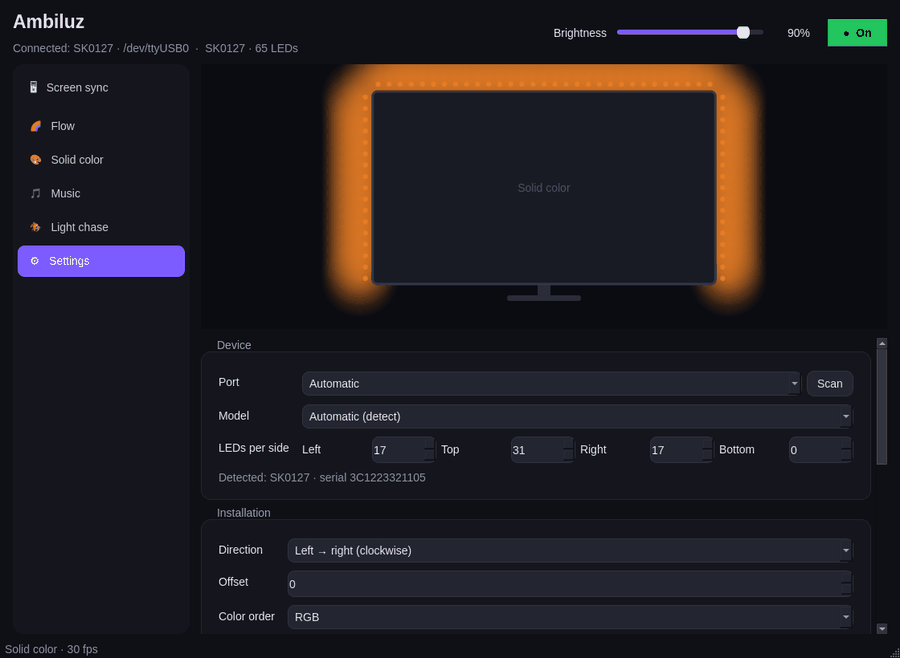
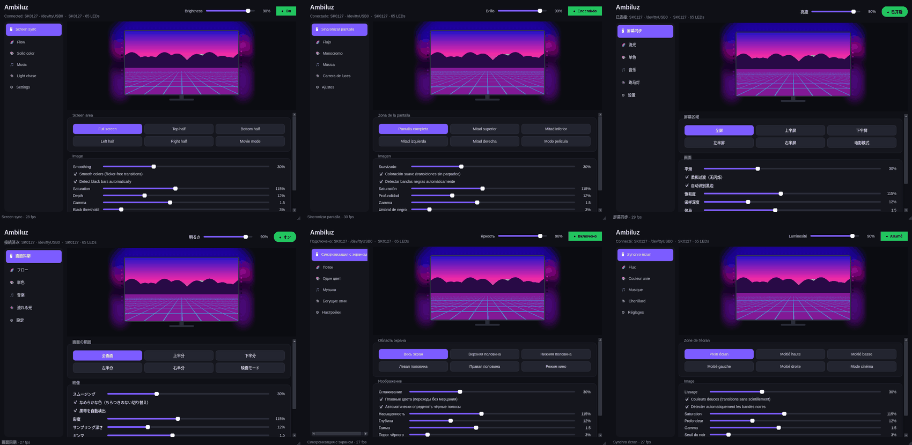

<div align="center">


# Ambiluz — Skydimo for Linux

**The missing Linux app for Skydimo monitor backlights.**
Ambilight-style screen sync on Wayland & X11, music mode, effects, tray icon. No Windows app needed.

[](https://github.com/SrNoelll/skydimo-linux/actions/workflows/ci.yml)
[](https://github.com/SrNoelll/skydimo-linux/releases)
[](LICENSE)


[](https://github.com/SrNoelll/skydimo-linux/stargazers)

**English** · [Español](docs/README.es.md) · [简体中文](docs/README.zh-CN.md) · [日本語](docs/README.ja.md) · [Русский](docs/README.ru.md) · [Français](docs/README.fr.md)


</div>

---

## ⚡ Install (one line)

```bash
curl -fsSL https://raw.githubusercontent.com/SrNoelll/skydimo-linux/main/install.sh | bash
```

Works on **Arch / CachyOS / Manjaro / EndeavourOS, Debian / Ubuntu / Mint / Pop!_OS, Fedora / Nobara, openSUSE**.
The installer installs the dependencies (it asks first), adds the app to your menu, the `ambiluz` command and a udev
rule so the strip works without extra groups. Then plug in the strip and open **Ambiluz** from your app menu.

<details>
<summary>Other ways to install</summary>

**Arch Linux (AUR-ready PKGBUILD)**

```bash
git clone https://github.com/SrNoelll/skydimo-linux.git && cd skydimo-linux/packaging/aur && makepkg -si
```

**From source**

```bash
git clone https://github.com/SrNoelll/skydimo-linux.git && cd skydimo-linux
./install.sh            # or just run it in place: python3 -m ambiluz
```

**Uninstall**

```bash
curl -fsSL https://raw.githubusercontent.com/SrNoelll/skydimo-linux/main/install.sh | bash -s -- --uninstall
```

</details>

## ✨ Features

| | |
|---|---|
| 🖥 **Screen sync (Ambilight)** | Full screen, top / bottom / left / right half and **movie mode**. Automatic **black-bar detection**, smoothing, saturation, gamma, depth. Captures through **xdg-desktop-portal + PipeWire** (KDE Plasma, GNOME, Hyprland, Sway…) or directly on **X11**. Remembers the chosen screen: no dialog every time. |
| 🎵 **Music mode** | Reacts to whatever your PC is playing (or the mic): **Spectrum, Pulse, VU meter, Ripples, Beat rainbow, Bass**. Rainbow, palette or fixed colors, beat detection, auto-gain. |
| 🌈 **Flow effects** | Rainbow, Gradient, Aurora, Wave, Breathing, Color cycle, Twinkle, Fire — with 13 palettes, speed, size and direction. |
| 🎨 **Solid color** | Color picker + swatches, with Static, Breathing, Heartbeat, Candle and Blink. |
| 🏇 **Light chase (跑马灯)** | Horse race, Marquee, Comet, Scanner, Blocks. |
| 🔌 **Plug & play** | Auto-detects the port and the **model** (asks the controller), reconnects if unplugged, survives suspend. |
| 🛠 **Calibration** | "Identify sides", LED-by-LED sweep and RGB tests; direction, offset, color order, white balance, FPS. Custom layouts for any LED count. |
| 🧰 **Desktop integration** | Tray icon, **starts with your PC by default** (one checkbox to turn it off), lights off when the screen locks or the PC sleeps, smooth fades, single instance, CLI. |
| 🌍 **6 languages** | English, Español, 简体中文, 日本語, Русский, Français (automatic, or pick it in Settings). |

## 📸 Screenshots

| Screen sync | Music |
|---|---|
|  |  |
| **Flow** | **Light chase** |
|  |  |
| **Solid color** | **Settings & calibration** |
|  |  |

<details>
<summary>🌍 In your language</summary>



</details>

## 🔦 Supported hardware

Skydimo USB LED strips and light bars with the **CH340 USB-serial controller** (`1a86:7523`). The model is detected
automatically:

| Series | Models (LEDs) |
|---|---|
| Monitor, 3 sides (SK01) | **SK0121** (51) · **SK0124** (54) · **SK0127** (65) · **SK0132** (77) · **SK0134** (71) · **SK0149** (107) |
| Monitor, 3 sides (SKA1) | **SKA124** (70) · **SKA127** (81) · **SKA132** (95) · **SKA134** (93) |
| Monitor, 4 sides (SK0L) | **SK0L21** (76) · **SK0L24** (80) · **SK0L27** (96) · **SK0L32** (114) · **SK0L34** (112) |
| Light bars | **SK0201** (40) · **SK0202** (60) · **SK0204** (50) |
| Lamps / strips | **SK0F01** (58) · **SK0F02** (50) · **SK0402** (72) · **SK0403** (96) |

Unknown model? It still works with a custom layout (Settings → Model → Custom). Please
[open an issue](https://github.com/SrNoelll/skydimo-linux/issues/new?template=new_model.yml) so it can be added.
Other Adalight-style CH340 strips that use the same protocol should work too.

> Tested on CachyOS (Arch) · KDE Plasma 6 · Wayland with an SK0127.

## ⌨️ Command line

```bash
ambiluz                    # open (or raise) the app
ambiluz --toggle           # on/off — bind it to a keyboard shortcut!
ambiluz --mode sync        # sync | flow | mono | music | race
ambiluz --brightness 60
ambiluz --color ff6a00     # solid color
ambiluz --probe            # detect the strip and print model / LEDs
ambiluz --status           # JSON status of the running app
```

## 🧩 Requirements

Python 3.9+, PySide6 (Qt 6), NumPy, PyGObject, GStreamer (base, good, PipeWire plugin), PipeWire or PulseAudio and
`xdg-desktop-portal` with your desktop's backend (`-kde`, `-gnome`, `-hyprland`, `-wlr`). The installer handles all of it.

## ❓ Troubleshooting

<details>
<summary>The strip is not found / "No permission"</summary>

- Run `ambiluz --probe`. You should see `/dev/ttyUSB0 … likely Skydimo`.
- Re-run the installer and accept the **udev rule**, then unplug and replug the strip.
- **Ubuntu/Debian:** the `brltty` package steals CH340 devices — `sudo apt remove brltty` (the installer offers it).
- Only one program can use the port: close OpenRGB, HyperHDR, Prismatik… if they are running.

</details>

<details>
<summary>Screen sync shows "permission cancelled" or nothing happens</summary>

- On Wayland a system dialog asks which screen to share: pick the monitor with the LEDs. Use
  **Choose another screen…** to change it later.
- Make sure the portal backend for your desktop is installed (`xdg-desktop-portal-kde`, `-gnome`, `-hyprland` or `-wlr`).
- KDE shows a "screen is being shared" indicator while syncing — that is expected.

</details>

<details>
<summary>Left and right are swapped / colors start in the wrong corner</summary>

Settings → Calibration → **Identify sides**: left must be red, top green, right blue. If not, change **Direction**;
use **Offset** if the strip starts in another corner.
</details>

<details>
<summary>No tray icon on GNOME</summary>

Install the *AppIndicator and KStatusNotifierItem Support* extension, or keep the window open.
</details>

## 🔬 How it works

Ambiluz talks to the controller over the serial port at 115200 baud using an Adalight-style frame
(`'A' 'd' 'a' 0x00 count_hi count_lo` + RGB × N) and asks the model with `Moni-A`. The screen is captured at a small
size through PipeWire, averaged per LED with an integral image, smoothed and sent at ~30 fps.
See [CONTRIBUTING.md](CONTRIBUTING.md) for the code layout.

## 🤝 Contributing

Issues and pull requests are welcome: new models, translations, effects, distro packages.
If Ambiluz is useful to you, **a ⭐ helps other Linux users find it.**

## ⚖️ License & disclaimer

[GPL-3.0-or-later](LICENSE). Ambiluz is an independent, unofficial project. It is **not affiliated with or endorsed by
Skydimo**; product names are used only to describe compatibility. Protocol details are based on public community
research ([SK0124 notes](https://github.com/amorwilliams/SK0124), [skydimo-rs](https://github.com/AirboZH/skydimo-rs),
and the [Skydimo OpenRGB fork](https://gitlab.com/skydimo-team/skydimo-open-rgb)).

<sub>Keywords: Skydimo Linux, Skydimo Ubuntu, Skydimo Arch, Skydimo Fedora, Skydimo Wayland, Skydimo KDE, Skydimo GNOME,
Ambilight Linux, monitor backlight Linux, PC ambient light Linux, Adalight Wayland, SK0124, SK0127, SK0132, SK0134.</sub>
