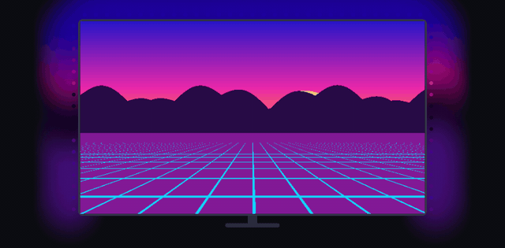

<div align="center">


# Ambiluz — Skydimo для Linux

**Приложение для Linux, которого не хватало подсветке мониторов Skydimo.**
Синхронизация с экраном в стиле Ambilight на Wayland и X11, режим музыки, эффекты, значок в трее. Приложение для Windows не нужно.

[English](../README.md) · [Español](README.es.md) · [简体中文](README.zh-CN.md) · [日本語](README.ja.md) · **Русский** · [Français](README.fr.md)



</div>

## ⚡ Установка одной командой

```bash
curl -fsSL https://raw.githubusercontent.com/SrNoelll/skydimo-linux/main/install.sh | bash
```

Работает в **Arch / CachyOS / Manjaro, Debian / Ubuntu / Mint, Fedora, openSUSE**. Установщик (спросив разрешения) ставит
зависимости, добавляет приложение в меню, команду `ambiluz` и правило udev. Подключите ленту и откройте **Ambiluz** из меню.

Удаление: `curl -fsSL https://raw.githubusercontent.com/SrNoelll/skydimo-linux/main/install.sh | bash -s -- --uninstall`

## ✨ Возможности

- 🖥 **Синхронизация с экраном:** весь экран, верхняя/нижняя/левая/правая половина и **режим кино**; автоопределение чёрных полос,
  сглаживание, насыщенность, гамма. Захват через **xdg-desktop-portal + PipeWire** (KDE Plasma, GNOME, Hyprland, Sway…) или напрямую в **X11**.
- 🎵 **Музыка:** реагирует на звук ПК (или микрофон): спектр, пульс, VU-метр, волны, ритмичная радуга, басы.
- 🌈 **Поток:** радуга, градиент, сияние, волна, дыхание, цикл цветов, мерцание, огонь — 13 палитр.
- 🎨 **Один цвет:** статичный, дыхание, сердцебиение, свеча, мигание.
- 🏇 **Бегущие огни:** скачки, бегущая строка, комета, сканер, блоки.
- 🔌 **Plug & play:** автоопределение порта и **модели**, переподключение после отключения и сна.
- 🛠 **Калибровка:** определение сторон, обход по светодиодам, RGB-тест, направление, смещение, порядок цветов, баланс белого.
- 🌍 **6 языков:** русский, English, Español, 简体中文, 日本語, Français.

## 🔦 Поддерживаемые модели

Ленты и панели Skydimo с USB-контроллером **CH340** (`1a86:7523`): SK0121, SK0124, SK0127, SK0132, SK0134, SK0149,
SKA124/127/132/134, SK0L21/24/27/32/34, SK0201/0202/0204, SK0F01/F02, SK0402/0403.
Модель не распознана? Используйте свою раскладку и [создайте issue](https://github.com/SrNoelll/skydimo-linux/issues/new?template=new_model.yml).

## ⌨️ Командная строка

```bash
ambiluz --toggle           # вкл/выкл (можно назначить на горячую клавишу)
ambiluz --mode music       # sync | flow | mono | music | race
ambiluz --probe            # определить ленту, модель и число светодиодов
```

Независимый неофициальный проект, не связанный со Skydimo. Лицензия [GPL-3.0](../LICENSE). Если пригодилось — поставьте ⭐!
